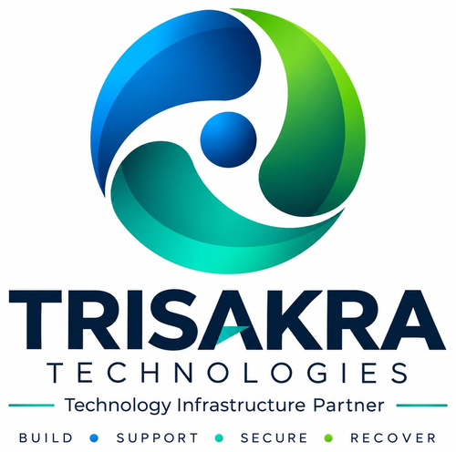

<p align="center"></p>

# Trisakra Transcript Studio

**Transcripts, subtitles and meeting notes, fully offline.**

Turn audio or video into text on your own Windows PC. No account, no uploads.
Powered by [faster-whisper](https://github.com/SYSTRAN/faster-whisper) (open source).

> **Status: early version (v0.1).** It works, but expect rough edges. Feedback welcome.

## Features
- Transcribe audio/video files (MP3, WAV, M4A, MP4, MKV and more)
- Automatic language detection
- Choose speed vs accuracy (tiny, base, small, medium)
- Auto-corrections for names and brands (`wrong=right; wrong=right`)
- Export as TXT, SRT and VTT subtitles
- Runs fully offline (the speech model downloads once on first use)

## Download (Windows, no Python needed)
Get the latest version from the **[Releases page](../../releases)**, unzip it, and double-click
**Trisakra Transcript Studio.exe**.

### Windows or antivirus warning
Because this is a new, independent app that is not yet code-signed, **Windows SmartScreen or your
antivirus may show a warning or wrongly flag it as suspicious.** This is a false alarm common to new
open-source apps. The full source code is in this repository for anyone to inspect.
- If Windows says **"Windows protected your PC"**, click **More info**, then **Run anyway**.
- If your antivirus blocks it, you may need to allow the file or add an exception.
- Download only from this repository's Releases page. If you prefer, run it from source (below).

## Run from source (for developers)
1. Install [Python 3.11 or newer](https://www.python.org/downloads/) and tick **"Add Python to PATH"**.
2. Download this project into a folder.
3. Open a command window in that folder and run:
   ```
   pip install -r requirements.txt
   python app.py
   ```

## Build the .exe yourself
Double-click `build.bat` (needs Python). The app appears in `dist\Trisakra Transcript Studio`.

## Roadmap
- Editable transcript before saving
- Setup installer with Start Menu shortcut
- Meeting recording, summaries, speaker labels, translation (Pro)

## License
MIT. Made by Trisakra Technologies.
